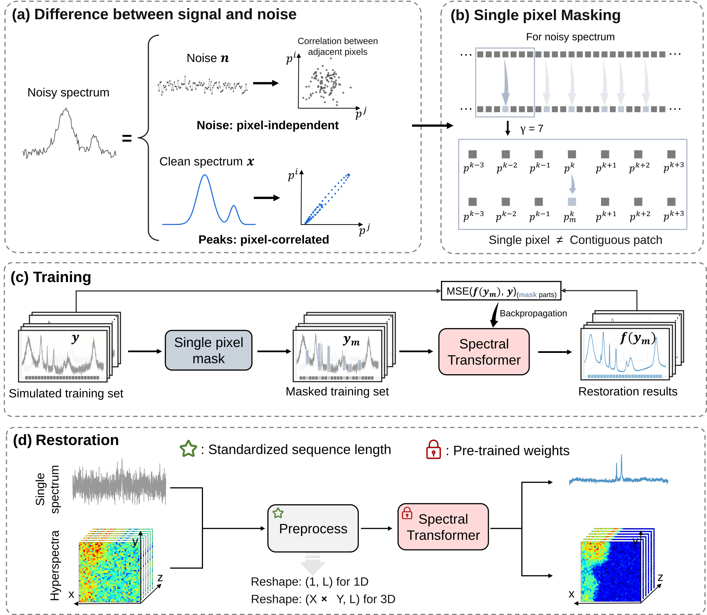

# Fast2Peak: High-Fidelity Restoration Algorithm by Single-Pixel Masking towards Real-Time Spectral Measurements

<p>
  <a href="https://arxiv.org/abs/2610.29753"></a>
  <a href="https://huggingface.co/moria5161/fast2peak"></a>
  <a href="LICENSE"></a>
</p>

## Abstract

Improving the temporal and spatial resolution of spectroscopy inevitably reduces the photons available to each measurement, pushing rapid measurements into photon-starved conditions where weak spectral features are obscured by stochastic background noise. Here, we present Fast2Peak (F2P), a self-supervised Transformer framework that transforms spectral restoration task into a context-prediction problem. Given that physically constrained spectral signals exhibit strong local continuity, whereas the stochastic noise fluctuate randomly and does not possess the continuity across neighboring spectral pixels, single-pixel masking enables F2P to restore the predictable signal structure while suppressing unpredictable fluctuations even without clean reference spectra. Unlike conventional offline spectral restoration, F2P achieves high-fidelity restoration within milliseconds, enabling real-time “acquire-and-process” operation. We demonstrate this capability in time-resolved electrochemical surface-enhanced Raman spectroscopy and hyperspectral Raman imaging, where spectral restoration is performed during data acquisition. In addition, F2P has demonstrated its robust generalization across different instruments and spectral modalities, including Raman, nuclear magnetic resonance, X-ray diffraction and Fourier-transform infrared spectroscopy.

## Framework of F2P




## Datasets and Checkpoints

The following resources are publicly available on Hugging Face:

| Resource | Download | Local placement |
|---|---|---|
| Pretraining and Raman benchmark data | [Datasets](https://huggingface.co/datasets/moria5161/fast2peak/tree/main/datasets) | Preserve `datasets/train/` and `datasets/test/`. |
| F2P, ResUNet and SMAE weights and configurations | [Checkpoints](https://huggingface.co/moria5161/fast2peak/tree/main/checkpoints) | For F2P, place the checkpoint and config in `experiments/f2p/checkpoints/`. |
| Real-time denoising demonstration | [Video](https://huggingface.co/datasets/moria5161/fast2peak/tree/main/real-time%20denoising%20video) | View online; not required for training or evaluation. |

Keep each checkpoint together with its accompanying `config.yaml`, which the inference entry point uses to restore the model configuration. IR, XRD and NMR-specific data and checkpoints are not included in the current Hugging Face upload.

## Getting Started

Run from the repository root. Tested with Python 3.12 and PyTorch 2.7.0 (CUDA 11.8).

```bash
conda create -n fast2peak python=3.12
conda activate fast2peak
python -m pip install torch==2.7.0 torchvision==0.22.0 --index-url https://download.pytorch.org/whl/cu118
python -m pip install -r requirements.txt
```

For CPU-only use, change the PyTorch index URL to `https://download.pytorch.org/whl/cpu`. See [PyTorch installation options](https://pytorch.org/get-started/previous-versions/#v270) for other platforms. GPU runtime results require a GPU.

## Usage

Prepare the resources above. On clusters, run training and inference on a compute node, not the login node.

### Training

Use `datasets/train/train.h5` and `datasets/train/val.h5`, each containing a `noisy` array of shape `[N, 1600]`. Training and validation are self-supervised; no `gt` is used.

**Masking note:** the `F2P` branch in `utils/spec_loader.py` currently uses `BlockMaskDataset` (`--block_size 8`). Restore its `MaskDataset` calls to reproduce the paper's single-pixel masking protocol; `--mask_ratio` alone does not switch strategies.

```bash
python main.py --train \
    --exp_name f2p_train \
    --model_name F2P \
    --train_data_dir datasets/train \
    --spectrum_length 1600 \
    --patch_size 16 --embed_dim 256 --depth 8 --heads 8 \
    --mask_ratio 0.05 --gamma 11 \
    --epochs 1000 --batch_size 512 \
    --lr 1e-4 --min_lr 1e-6 --warmup_epochs 10 \
    --weight_decay 1e-3 --seed 615
```

For single-node multi-GPU training, replace `python main.py --train` with `torchrun --standalone --nproc_per_node=4 main.py --train --ddp`. Match the process count to your GPUs; `--batch_size` is per GPU.

The lowest validation masked MSE selects `experiments/f2p_train/checkpoints/best_checkpoint.pth`, saved alongside `config.yaml`. Logs: `logs/f2p_train`.

### Evaluation

Test HDF5 files contain matching `noisy` and `gt` arrays of shape `[N, L]`. Without `gt`, only denoised spectra are saved.

```bash
python main.py --test \
    --test_model_path experiments/f2p_train/checkpoints/best_checkpoint.pth \
    --test_datapath datasets/test/Simu.h5 \
    --test_batch_size 1024
```

To skip training, use the released pretrained checkpoint with its adjacent `config.yaml`. Evaluate in a single process, without `--ddp`.

Outputs in `experiments/f2p_train/output/YYYY-MM-DD/`:

- `Simu.h5`: `denoised` predictions.
- `Simu_eval.log`: mean SNR (dB), RMSE and SSS (requires `gt`).
- `Simu_metrics_details.csv`: per-spectrum metrics.

F2P inference includes noisy-input-based amplitude correction. IR, XRD and NMR use separate evaluators below.

### Key Arguments

| Argument | Description |
|---|---|
| `--train` / `--test` | Train or evaluate. |
| `--exp_name` | Experiment name for checkpoints and logs. |
| `--train_data_dir` | Directory containing `train.h5` and `val.h5`. |
| `--mask_ratio` | Masked fraction: `0.05` above; CLI default `0.25`. |
| `--gamma` | Replacement neighborhood parameter. |
| `--test_model_path` | Checkpoint with adjacent `config.yaml`. |
| `--test_datapath` | Test file or directory. |
| `--test_batch_size` | Inference batch size; adjust for GPU memory. |

### Training Logs

```bash
tensorboard --logdir logs/f2p_train
```

## Benchmark Reproduction

[IR](otherbench/IR/), [XRD](otherbench/XRD/) and [NMR](otherbench/NMR/) provide modality-specific code and configurations; each requires its own data and model assets. See [final results](otherbench/RESULTS.md).

## Citation

Please cite our [arXiv preprint](https://arxiv.org/abs/2610.29753):

```bibtex
@misc{zhang2026fast2peak,
  title = {Fast2Peak: High-Fidelity Restoration Algorithm by Single-Pixel Masking towards Real-Time Spectral Measurements},
  author = {Nan-Nan Zhang and Si-Heng Luo and Xin-Di Pei and Wen-Xuan Li and Jun Wang and Yi-Fan Bao and Hao Ma and Guo-Kun Liu and Bin Ren},
  year = {2026},
  eprint = {2610.29753},
  archivePrefix = {arXiv},
  primaryClass = {physics.optics},
  url = {https://arxiv.org/abs/2610.29753}
}
```

## License

Copyright 2026 Fast2Peak contributors. Original Fast2Peak code and documentation are licensed under the [Apache License 2.0](LICENSE).

Third-party code retains its original ownership and terms. The IR utilities in `otherbench/IR/utils/upstream/` are GPL-3.0-or-later; the [GPL text](LICENSES/GPL-3.0.txt) and source notices are retained. See the [SMAE provenance](othermethods/smae/docs/provenance.md) and source attribution in the NMR model files. Baseline files with unresolved provenance or permissions are excluded from the Apache grant pending review; attribution alone does not grant redistribution rights.

Datasets, model weights and third-party fonts are not covered by this code license and require separate terms.

## Contact

Questions: open an issue or email [moria5161@stu.xmu.edu.cn](mailto:moria5161@stu.xmu.edu.cn).
